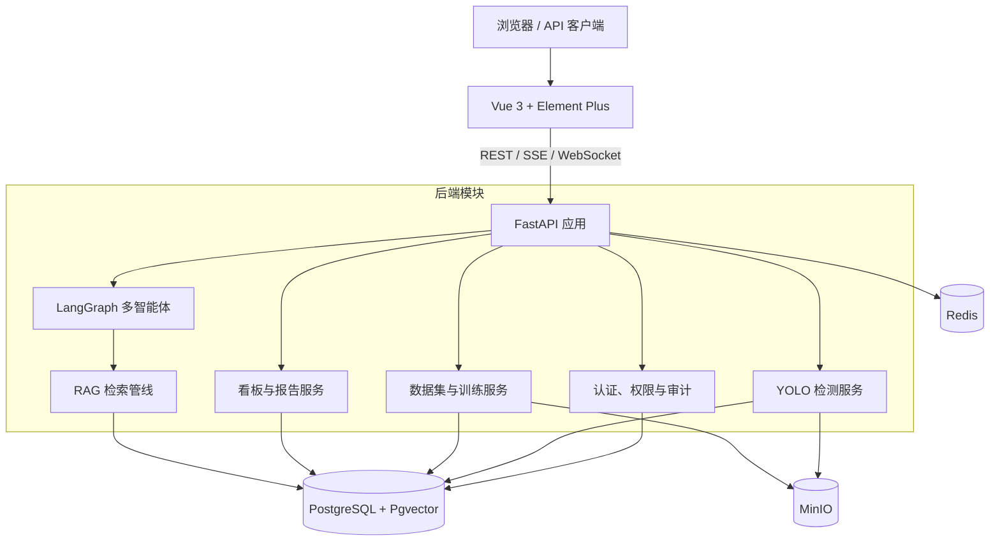

<p align="center">
  
</p>

<h1 align="center">芯明鉴</h1>

<p align="center">
  基于 YOLOv11 与多智能体协作的 PCB 缺陷检测及模型全生命周期管理平台
</p>

## 项目简介

芯明鉴面向 PCB 缺陷检测、数据集治理、模型训练和质量分析场景，提供从数据导入到模型部署验证的完整工作流。系统以 YOLOv11 为视觉检测核心，以 LangGraph 编排多智能体，通过 PostgreSQL、Redis、MinIO 和 Pgvector 管理业务数据、会话状态、检测资产与领域知识。

项目采用前后端分离的模块化单体架构，支持单图、批量、ZIP、视频和摄像头检测，并提供训练过程监控、模型版本管理、检测报告、数据看板、多用户权限和操作审计等能力。

> 当前版本：`0.1.0`。项目处于持续迭代阶段，生产部署前请完成本文的安全配置、数据库迁移和基础设施检查。

## 目录

- [核心能力](#核心能力)
- [系统架构](#系统架构)
- [技术栈](#技术栈)
- [仓库结构](#仓库结构)
- [快速开始](#快速开始)
- [配置说明](#配置说明)
- [数据集与模型](#数据集与模型)
- [API 与服务检查](#api-与服务检查)
- [测试与质量保证](#测试与质量保证)
- [生产部署](#生产部署)
- [安全建议](#安全建议)
- [协作规范](#协作规范)
- [数据集来源](#数据集来源)
- [许可证](#许可证)

## 核心能力

| 领域 | 能力 |
| --- | --- |
| 智能检测 | 支持单图、批量图片、文件夹、ZIP、视频和浏览器摄像头检测；支持置信度、IoU、图像尺寸与运行设备配置 |
| 智能体协作 | Supervisor 根据意图调度 Detection、Analysis 和 Management Agent，支持检测后分析、并行查询与流式回复 |
| 数据集管理 | 支持 YOLO、VOC、COCO、LabelMe 数据集 ZIP 导入，统一转换为 YOLO 目录并执行结构、标注和图像校验 |
| 模型训练 | 支持 YOLOv11 训练任务、进度跟踪、Loss 与指标曲线、停止训练、恢复任务、结果下载和测试图验证 |
| 模型管理 | 支持训练模型版本化、评估结果保存、默认模型切换、逻辑归档、本地与 MinIO 模型资产管理 |
| 质量分析 | 提供检测趋势、类别分布、场景分布、任务类型分布和质量快照 |
| 报告归档 | 生成包含统计图、证据图和 AI 分析的 Markdown 报告，并支持离线 ZIP 归档 |
| 多用户与审计 | 提供 JWT 认证、RBAC 角色权限、用户数据隔离、管理员视图和关键操作审计 |
| RAG 知识库 | 将 PCB 缺陷、YOLO 基础和评估指标文档向量化，通过 Pgvector 为分析 Agent 提供领域上下文 |

## 系统架构



系统当前以单个 FastAPI 应用提供服务。检测和训练长任务由后端进程内线程执行，Redis 负责限流、Token 黑名单、任务锁和部分会话状态。该实现仅适合单个 Uvicorn worker；当前生产镜像默认配置的 4 个 worker 与进程内任务状态不兼容，部署时必须覆盖为单 worker。扩展到多进程或多后端实例前，应先将长任务迁移至集中式任务队列。

## 技术栈

### 前端

- Vue 3、Vue Router、Pinia
- Vite 8、Vitest
- Element Plus、ECharts
- Axios、Markdown-it、Sass

### 后端

- Python 3.11、FastAPI、Uvicorn
- SQLAlchemy、Alembic、Pydantic
- Ultralytics YOLOv11、PyTorch、OpenCV、Pillow
- LangChain、LangGraph、OpenAI 兼容 API
- PostgreSQL、Pgvector、Redis、MinIO

### 工程化

- Docker、Docker Compose、Nginx
- GitHub Actions、GitHub Container Registry
- Pytest、Vitest

## 仓库结构

```text
xinmingjian/
├── backend/
│   ├── app/
│   │   ├── agent/          # Supervisor、子 Agent、工具和会话记忆
│   │   ├── api/            # REST、SSE 和 WebSocket 路由
│   │   ├── config/         # 环境变量与应用配置
│   │   ├── core/           # 安全、日志与异常处理
│   │   ├── database/       # SQLAlchemy 引擎和会话
│   │   ├── entity/         # ORM 实体与 Pydantic Schema
│   │   ├── middleware/     # 请求日志与 Redis 限流
│   │   ├── rag/            # 文档加载、Embedding 与检索
│   │   ├── services/       # 检测、报告、看板等业务服务
│   │   ├── storage/        # Redis 与 MinIO 客户端
│   │   ├── training/       # 数据转换、拆分和训练服务
│   │   └── vectorstore/    # Pgvector 存储访问
│   ├── alembic/            # 数据库迁移脚本
│   ├── knowledge_base/     # 内置领域知识文档
│   ├── tests/              # 后端自动化测试
│   ├── tools/              # 数据集、训练、评估和管理脚本
│   └── main.py             # FastAPI 应用入口
├── frontend/
│   ├── src/
│   │   ├── api/            # 后端 API 封装
│   │   ├── components/     # 业务与通用组件
│   │   ├── router/         # 路由和权限守卫
│   │   ├── stores/         # Pinia 状态管理
│   │   ├── utils/          # 请求、流式通信与格式化工具
│   │   └── views/          # 页面视图
│   ├── tests/              # 前端自动化测试
│   └── nginx.conf          # 生产静态站点与 API 代理配置
├── docs/                   # 教程、设计说明与协作规范
├── .github/workflows/      # CI、镜像构建与部署工作流
├── docker-compose.yml      # 本地 PostgreSQL、Redis、MinIO
└── docker-compose.server.yml # 生产部署模板
```

## 快速开始

### 环境要求

| 依赖 | 建议版本 | 用途 |
| --- | --- | --- |
| Git | 2.40+ | 源码管理 |
| Docker Desktop / Docker Engine | 24+ | 启动 PostgreSQL、Redis 和 MinIO |
| Docker Compose | v2 | 本地基础设施编排 |
| Python | 3.11 | 后端运行环境 |
| Node.js | `^20.19.0` 或 `>=22.12.0` | 前端构建与开发 |
| NVIDIA CUDA | 可选 | 本机 GPU 推理或训练 |

### 1. 获取源码

```bash
git clone https://github.com/shanhe321/PCB-Defect-Finder.git xinmingjian
cd xinmingjian
```

### 2. 启动本地基础设施

根目录的 `docker-compose.yml` 仅负责 PostgreSQL、Redis 和 MinIO：

```bash
docker compose up -d
docker compose ps
```

默认端口如下：

| 服务 | 地址 |
| --- | --- |
| PostgreSQL | `localhost:5432` |
| Redis | `localhost:6379` |
| MinIO API | `http://localhost:9000` |
| MinIO Console | `http://localhost:9001` |

### 3. 配置并启动后端

在 PowerShell 中执行：

```powershell
Copy-Item backend/.env.example backend/.env
cd backend
py -3.11 -m venv .venv
.\.venv\Scripts\Activate.ps1
python -m pip install --upgrade pip
pip install -r requirements.txt
```

> 上述激活命令中的路径应为 `.venv\Scripts\Activate.ps1`。如果 PowerShell 禁止执行激活脚本，也可以直接使用 `.venv\Scripts\python.exe` 执行后续 Python 命令。

将 `backend/.env` 中的本地基础设施配置调整为：

```dotenv
DB_HOST=localhost
DB_PORT=5432
DB_NAME=rsod_agent
DB_USER=rsod_admin
DB_PASSWORD=rsod_admin

REDIS_HOST=localhost
REDIS_PORT=6379
REDIS_PASSWORD=

MINIO_ENDPOINT=localhost:9000
MINIO_ACCESS_KEY=minioadmin
MINIO_SECRET_KEY=minioadmin
MINIO_SECURE=false
```

随后执行数据库迁移并创建管理员：

```powershell
alembic upgrade head
python -m tools.create_admin --username admin --email admin@example.com
```

管理员密码通过终端安全输入，不会出现在命令历史中。也可以在 `.env` 中临时配置 `BOOTSTRAP_ADMIN_*`，由应用在系统没有管理员时自动初始化；创建成功后应立即移除明文密码。

启动后端：

```powershell
uvicorn main:app --host 0.0.0.0 --port 8000 --reload
```

### 4. 配置并启动前端

新开一个终端：

```powershell
cd frontend
npm ci
npm run dev
```

本地访问入口：

| 页面或服务 | 地址 |
| --- | --- |
| Web 应用 | `http://localhost:5173` |
| OpenAPI 文档 | `http://localhost:8000/docs` |
| ReDoc | `http://localhost:8000/redoc` |
| 后端健康检查 | `http://localhost:8000/api/health` |

Vite 会将 `/api` 和摄像头 WebSocket 请求代理到 `VITE_DEV_PROXY_TARGET`，默认值为 `http://localhost:8000`。

## 配置说明

后端配置由 `backend/.env` 提供，完整字段和说明见 [`backend/.env.example`](backend/.env.example)。优先检查以下配置：

| 配置组 | 关键变量 | 说明 |
| --- | --- | --- |
| 应用 | `DEBUG`、`PUBLIC_BASE_URL`、`TRUSTED_HOSTS` | 控制调试模式、公开媒体地址和 Host 校验 |
| 数据库 | `DB_HOST`、`DB_PORT`、`DB_NAME`、`DB_USER`、`DB_PASSWORD` | PostgreSQL 连接参数 |
| 缓存 | `REDIS_HOST`、`REDIS_PORT`、`REDIS_PASSWORD` | 限流、会话、Token 黑名单与任务锁 |
| 对象存储 | `MINIO_ENDPOINT`、`MINIO_ACCESS_KEY`、`MINIO_SECRET_KEY` | 检测图片、报告和模型对象 |
| 认证 | `JWT_SECRET_KEY`、`ACCESS_TOKEN_EXPIRE_MINUTES` | JWT 签名和有效期 |
| 模型服务 | `QWEN_*`、`OPENAI_*` | 智能体和 Embedding 的 OpenAI 兼容服务 |
| RAG | `EMBEDDING_MODEL`、`EMBEDDING_DIM`、`RAG_TOP_K` | 向量模型、维度和召回数量 |
| 训练 | `TRAIN_OUTPUT_DIR`、`DATASET_BASE_DIR`、`TRAIN_WORKERS` | 训练输出、数据目录和 DataLoader 并发 |

前端本地配置见 [`frontend/.env.example`](frontend/.env.example)。生产构建通过同源 `/api` 访问后端，不应将数据库、Redis 或 MinIO 凭据暴露给浏览器。

### LLM 与 RAG

- 配置有效的 `QWEN_API_KEY` 时，系统优先使用通义千问兼容接口。
- 未配置有效的 Qwen Key 时，系统使用 `OPENAI_*` 配置。
- `EMBEDDING_DIM` 必须与实际 Embedding 模型输出一致。
- 知识库会在首次检索时延迟构建；管理员也可以调用 `POST /api/knowledge/build` 主动构建或重建索引。
- 修改向量模型维度后，需要重建 `knowledge_embeddings` 表和索引。

### CUDA 与设备选择

本地 GPU 推理和训练要求当前 Python 环境中的 PyTorch 能识别 CUDA：

```powershell
python -c "import torch; print(torch.cuda.is_available(), torch.cuda.device_count())"
```

如果输出为 `False 0`，请参考 [PyTorch 官方安装说明](https://pytorch.org/get-started/locally/)，安装与显卡驱动和 CUDA 版本匹配的 PyTorch，再选择 `device=0`。无法识别 CUDA 时应使用 `device=cpu`。当前后端 Dockerfile 安装的是 CPU 版 PyTorch，不能直接用于容器内 GPU 推理。

## 数据集与模型

### 支持的数据集格式

- YOLO
- Pascal VOC
- COCO
- LabelMe

导入接口接收 ZIP 压缩包。VOC、COCO 和 LabelMe 标注会在服务端转换为统一 YOLO 训练目录，然后进行数据划分和完整性校验。

### 本地数据目录

| 路径 | 内容 | Git 策略 |
| --- | --- | --- |
| `backend/datasets/` | 导入和转换后的数据集 | 忽略 |
| `backend/runs/train/` | YOLO 训练过程与权重 | 忽略 |
| `backend/models/` | 正式模型版本及评估资产 | 忽略 |
| `backend/logs/` | 后端运行日志 | 仅跟踪 `.gitkeep` |

这些目录可能包含大体积文件或业务数据，不应直接提交到 Git。正式环境应通过持久卷、对象存储和备份策略管理。

## API 与服务检查

### 主要 API

| 前缀 | 说明 |
| --- | --- |
| `/api/auth` | 注册、登录、当前用户和安全退出 |
| `/api/user` | 用户资料、角色和管理员用户管理 |
| `/api/detection` | 单图、批量、ZIP、视频和摄像头检测 |
| `/api/datasets` | 数据集创建、导入、校验和删除 |
| `/api/training` | 训练任务、指标、评估、模型版本与下载 |
| `/api/chat` | 文件上传、SSE 智能对话和会话历史 |
| `/api/history` | 检测历史、报告下载和重新检测 |
| `/api/dashboard` | 概览、趋势和分布统计 |
| `/api/scenes` | 检测场景和类别映射 |
| `/api/knowledge` | RAG 索引、统计和检索 |
| `/api/storage` | 带签名的对象存储代理访问 |
| `/api/audit` | 管理员操作审计 |

完整请求参数和响应结构以运行中的 OpenAPI 文档为准。

### 健康检查

```powershell
Invoke-RestMethod http://localhost:8000/api/health
Invoke-RestMethod http://localhost:8000/api/health/detail
```

`/api/health` 只检查应用进程；`/api/health/detail` 会同时检查 PostgreSQL、Redis 和 MinIO。部署验收应使用详细检查，不能仅以容器处于 `healthy` 状态作为应用可用的依据。

## 测试与质量保证

### 后端测试

```powershell
cd backend
.\.venv\Scripts\python.exe -m pytest
```

### 前端测试与构建

```powershell
cd frontend
npm run test:run
npm run build
```

### 提交前检查

```powershell
git diff --check
git status --short
```

当变更命中 CI 监控路径时，GitHub Actions 会在面向 `main` 或 `develop` 的 Push 和 Pull Request 上执行前端构建、后端检查和 Compose 配置检查。当前工作流在 Compose 检查失败时会降级为 YAML 语法检查，因此部署前仍须在已准备根目录 `.env` 的环境中手动执行严格校验。

## 生产部署

[`docker-compose.server.yml`](docker-compose.server.yml) 是面向服务器的部署模板，使用 GHCR 中的前后端镜像。它不是本地源码开发的一键启动器，也不会自动执行 Alembic 迁移。模板当前使用普通 PostgreSQL 镜像，且后端镜像默认启动 4 个 Uvicorn worker；部署时必须使用本节的覆盖配置修正这两项。

部署前必须完成以下工作：

1. 将 [`backend/.env.example`](backend/.env.example) 复制到根目录并命名为 `.env`，替换其中的域名、密码、密钥和管理员初始凭据，再补充 Compose 使用的 `POSTGRES_*` 与 `MINIO_ROOT_*` 变量。
2. 将后端容器地址设置为 `DB_HOST=db`、`REDIS_HOST=redis`、`MINIO_ENDPOINT=minio:9000`。
3. 保证 `POSTGRES_*` 与对应的 `DB_*`、`MINIO_ROOT_*` 与对应的 `MINIO_*` 使用相同的数据库名称、用户名和密码。
4. 准备未跟踪的 `docker-compose.production.override.yml`，将数据库替换为 Pgvector 镜像，并将后端固定为单个 Uvicorn worker。
5. 登录 GHCR，并确认部署账户有权拉取芯明鉴的前后端镜像。
6. 先启动 PostgreSQL、Redis 和 MinIO，再执行数据库迁移，最后启动应用服务。

复制环境文件后，至少确认以下配置；示例中的密码和域名必须替换：

```dotenv
APP_NAME=芯明鉴
DEBUG=false
PUBLIC_BASE_URL=https://xinmingjian.example.com
TRUSTED_HOSTS=xinmingjian.example.com
TRUST_PROXY_HEADERS=true
ALLOWED_ORIGINS=https://xinmingjian.example.com

POSTGRES_DB=rsod_agent
POSTGRES_USER=rsod_admin
POSTGRES_PASSWORD=replace-with-a-strong-database-password
DB_HOST=db
DB_PORT=5432
DB_NAME=rsod_agent
DB_USER=rsod_admin
DB_PASSWORD=replace-with-a-strong-database-password

REDIS_HOST=redis
REDIS_PASSWORD=
MINIO_ROOT_USER=replace-with-a-minio-access-key
MINIO_ROOT_PASSWORD=replace-with-a-strong-minio-secret
MINIO_ENDPOINT=minio:9000
MINIO_ACCESS_KEY=replace-with-a-minio-access-key
MINIO_SECRET_KEY=replace-with-a-strong-minio-secret
```

生产覆盖文件内容如下：

```yaml
services:
  backend:
    command:
      - uvicorn
      - main:app
      - --host
      - 0.0.0.0
      - --port
      - "8000"
      - --workers
      - "1"
      - --proxy-headers
      - --forwarded-allow-ips
      - "*"
  db:
    image: pgvector/pgvector:pg16
```

参考顺序：

```bash
cp backend/.env.example .env
# 编辑 .env，补充 POSTGRES_* 和 MINIO_ROOT_*，并替换所有占位值
docker compose -f docker-compose.server.yml -f docker-compose.production.override.yml config --quiet
docker compose -f docker-compose.server.yml -f docker-compose.production.override.yml pull
docker compose -f docker-compose.server.yml -f docker-compose.production.override.yml up -d db redis minio
docker compose -f docker-compose.server.yml -f docker-compose.production.override.yml run --rm backend alembic upgrade head
docker compose -f docker-compose.server.yml -f docker-compose.production.override.yml up -d backend frontend
docker compose -f docker-compose.server.yml -f docker-compose.production.override.yml ps
```

公网部署还需要在可信反向代理上完成：

- HTTPS 证书和 HTTP 到 HTTPS 跳转；
- `/api` 反向代理；
- `/api/detection/camera` 的 WebSocket Upgrade 转发；
- SSE 禁用代理缓冲并配置合理超时；
- 上传体积、请求速率和访问日志策略。

浏览器摄像头 API 通常只允许在 HTTPS 安全上下文或 `localhost` 中使用。仅开放公网 IP 的 HTTP 页面无法可靠获得摄像头权限。

## 安全建议

- 生产环境必须设置 `DEBUG=false`。
- 替换默认数据库、Redis、MinIO 和 JWT 密钥，不要提交任何 `.env` 文件。
- 将 `TRUSTED_HOSTS` 和 `ALLOWED_ORIGINS` 限制为实际域名。
- 只有在请求经过可信反向代理时才启用 `TRUST_PROXY_HEADERS=true`。
- 首次管理员创建后，从环境变量中移除 `BOOTSTRAP_ADMIN_PASSWORD`。
- 对数据库、MinIO 和训练模型建立独立备份与恢复策略。
- 定期检查操作审计、失败任务、存储容量和依赖安全更新。

如发现安全问题，请勿在公开 Issue 中披露密钥、Token、内部地址或可复现的生产凭据。

## 协作规范

项目采用 `main`、`develop` 和功能分支协作模式。详细规范见 [`docs/git-collaboration-guide.md`](docs/git-collaboration-guide.md)。

基本流程：

1. 从最新 `develop` 创建 `feature/*`、`bugfix/*` 或 `hotfix/*` 分支。
2. 使用 Conventional Commits 编写提交信息。
3. 提交前运行相关测试、构建和 `git diff --check`。
4. 通过 Pull Request 合并到 `develop`，发布阶段再合并到 `main`。
5. PR 中说明变更范围、兼容性影响、测试结果和必要的迁移步骤。

## 数据集来源

仓库不跟踪训练数据集。使用第三方数据前，请确认其许可、引用要求和适用范围。

### Tiny PCB Defect Dataset

- 项目：[Tiny-Defect-Detection-for-PCB](https://github.com/Ixiaohuihuihui/Tiny-Defect-Detection-for-PCB)
- 百度网盘：[下载链接](https://pan.baidu.com/s/1eAxDF4txpgMInxbmNDX0Zw)，提取码：`a6rh`
- Dropbox：[VOC_PCB.zip](https://www.dropbox.com/s/h0f39nyotddibsb/VOC_PCB.zip?dl=0)
- 相关 YOLO 实现：[YOLO-PCB](https://github.com/JiaLim98/YOLO-PCB)

### PCBA Dataset

- 项目：[PCBA-Dataset](https://github.com/ismh16/PCBA-Dataset)
- 示例数据：[Google Drive](https://drive.google.com/file/d/1lmMe3o7kZG67zcL2ZbJJFfXPpMLWzV2k/view?usp=sharing)
- VOC 标注的 YOLO 格式版本：[Google Drive](https://drive.google.com/file/d/1T0ogvDWhaGrODb6H5r4KLzpIeFMv5oQO/view?usp=drive_link)
- PCB 缺陷标注的 YOLO 格式版本：[Google Drive](https://drive.google.com/file/d/1wJ94UB-0KCXy-Ytom7Yf5KwMV4io8Ghw/view?usp=drive_link)

第三方数据集和参考实现不受本仓库 MIT 许可证自动覆盖，其版权和使用条件以原项目说明为准。

## 许可证

本项目基于 [MIT License](LICENSE) 开源。

Copyright (c) 2026 Jinshan Liu.
